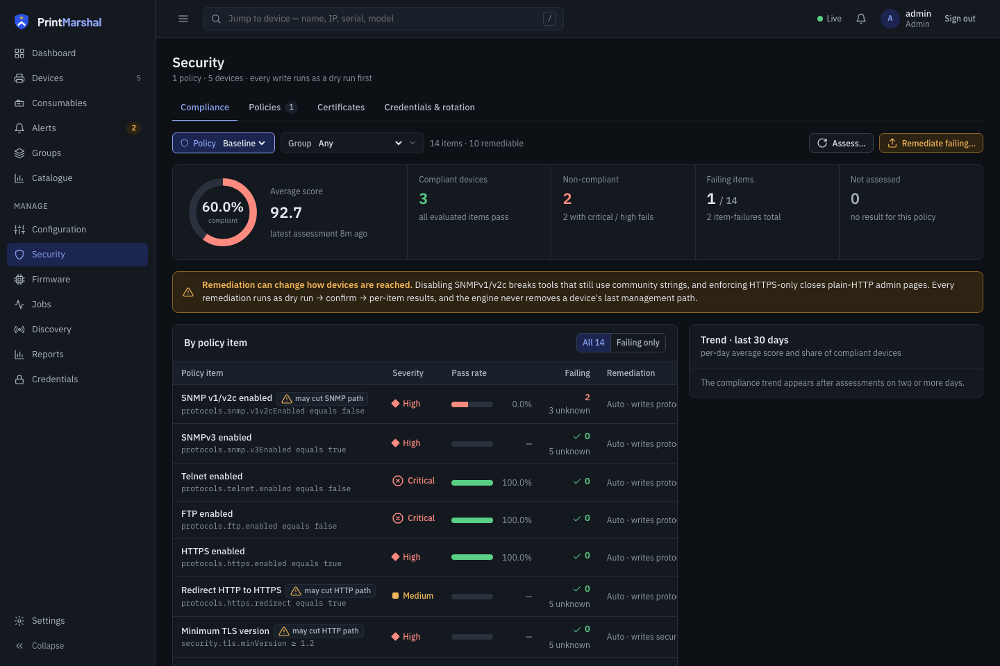

<p align="center">
  <picture>
    <source media="(prefers-color-scheme: dark)" srcset="brand/logo-horizontal-on-dark.svg">
    
  </picture>
</p>

<p align="center"><strong>Know where your printer fleet is exposed.</strong><br>
A self-hosted, open-source console for printer fleet security, configuration and monitoring.</p>

<p align="center">
  <a href="https://github.com/printmarshal/printmarshal/actions/workflows/ci.yml"></a>
  <a href="LICENSE"></a>
  
  
  
</p>

<p align="center">
  <a href="https://printmarshal.app">Website</a> ·
  <a href="https://github.com/printmarshal/printmarshal/wiki">Wiki</a> ·
  <a href="https://github.com/printmarshal/printmarshal/wiki/Installation-and-deployment">Install</a> ·
  <a href="https://github.com/printmarshal/printmarshal/wiki/API-reference">API</a> ·
  <a href="https://github.com/printmarshal/printmarshal/security/policy">Security policy</a>
</p>

Printers hold network credentials, TLS certificates and open management ports, yet most
teams only notice them when the toner runs out. PrintMarshal discovers your fleet over
standard SNMP, IPP and eSCL, audits each device's security without counting an unreadable
setting as a pass, previews configuration changes as a diff before writing, and verifies
every write by reading the device back. It runs on your own host, speaks open standards to
any printer, and depends on no manufacturer's management software.

<p align="center">
  
  <br><sub>Fleet security overview, simulator data.</sub>
</p>

## What it does

- **Discovers and inventories** the fleet with mDNS, WS-Discovery and bounded active scans,
  reconciled by serial, UUID, MAC and address, with operator-set fields a scan never
  overwrites. [Discovery and inventory](https://github.com/printmarshal/printmarshal/wiki/Discovery-and-inventory)
- **Monitors** status, supplies, trays, counters and firmware on a schedule, keeps telemetry,
  listens for SNMP traps, and raises alerts to Slack, Teams, Discord, webhooks or email.
  [Monitoring and alerts](https://github.com/printmarshal/printmarshal/wiki/Monitoring-and-alerts)
- **Assesses security** against policies with pass, fail and *unknown* results, probes TLS and
  open ports, enrols certificates over SCEP, EST or ACME, and remediates with a dry run first.
  [Security](https://github.com/printmarshal/printmarshal/wiki/Security)
- **Manages configuration** as normalised documents: snapshots, device-to-device diff, named
  profiles, drift reports, and gated writes that run as audited jobs with rollback.
  [Configuration management](https://github.com/printmarshal/printmarshal/wiki/Configuration-management)
- **Runs firmware campaigns** in waves with a canary gate, maintenance windows, failure
  auto-pause and read-back verification. [Firmware](https://github.com/printmarshal/printmarshal/wiki/Firmware)
- **Tracks consumables** as a stock inventory linked to the devices that use each part, with
  forecasts, replacement detection and CSV import and export.
  [Consumables and stock](https://github.com/printmarshal/printmarshal/wiki/Consumables-and-stock)
- **Reports** on utilisation, fleet health, supplies, alerts and firmware over any date range,
  as JSON or CSV. [Reports](docs/reports.md)
- **Shows evidence, not promises.** A research catalogue of 15 brands and 495 model identifiers
  records what each vendor documents, what PrintMarshal has observed, and what is unknown,
  and never collapses them into "supported". [Catalogue](docs/catalogue.md)
- **Integrates** through a REST and WebSocket API, local accounts or OpenID Connect, SAML,
  LDAP/Active Directory and RADIUS sign-in, scoped API tokens, and SIEM export over syslog
  or HTTP with an incremental sync API for CMDB and ITSM tools.
  [Identity and access](https://github.com/printmarshal/printmarshal/wiki/Identity-and-access) ·
  [Events, notifications and integrations](https://github.com/printmarshal/printmarshal/wiki/Events-notifications-and-integrations)
- **Optionally serves print queues** through a CUPS / IPP Everywhere bridge on the host, off
  by default. [Print provider](https://github.com/printmarshal/printmarshal/wiki/Print-provider)

Vendor plugins for Brother, Canon, Epson, Fujifilm, HP, Konica Minolta, Kyocera, Lexmark, OKI,
Ricoh, Sharp, Toshiba and Xerox enrich what the standards drivers see; see
[Vendor plugins and drivers](https://github.com/printmarshal/printmarshal/wiki/Vendor-plugins-and-drivers).

## What it is not

PrintMarshal manages *devices*, not print jobs. It is not a print-accounting, quota,
cost-allocation or pull-printing product, and it has no cloud component: nothing leaves
your network unless you configure a notifier or an export.

## Quick start

Requirements: Go 1.27.3+ (matching `go.mod`) and Node 20+ to build the UI, or Docker.

```bash
make web        # build the SPA into internal/web/dist (once, or after UI changes)
make build      # bin/printmarshal and bin/pm-sim
PM_ADMIN_PASSWORD=change-me ./bin/printmarshal
```

Open <http://localhost:8080>, sign in as `admin`, go to **Discovery** and start a run.
Without `PM_ADMIN_PASSWORD` the first start generates a password and writes it to
`<data dir>/initial-admin-password` (mode 0600); change it after signing in and delete the file.

To try it without a printer, run the simulator and point the server at its ports:

```bash
./bin/pm-sim -fixture testdata/fixtures/generic-laser.snmp -snmp 127.0.0.1:1161 -ipp 127.0.0.1:6631
PM_SNMP_PORT=1161 PM_IPP_ENDPOINTS='http://%s:6631/ipp/print' PM_ADMIN_PASSWORD=change-me ./bin/printmarshal
# then discover target 127.0.0.1 with zero-config off
```

## Deploying

```bash
make docker                                   # multi-stage image, non-root, /healthz check
docker run -d --name printmarshal --network host \
  -e PM_ADMIN_PASSWORD=change-me -v pm-data:/data printmarshal:latest
```

- **Docker Compose**: `docker compose -f deploy/docker-compose.yml up -d --build`
- **Kubernetes**: manifests in [`deploy/kubernetes/`](deploy/kubernetes/) or the Helm chart in
  [`deploy/helm/printmarshal/`](deploy/helm/printmarshal/)
- **Bare Linux host**: the [`deploy/systemd/`](deploy/systemd/) unit and environment file
- **Backups**: [`deploy/scripts/backup.sh`](deploy/scripts/backup.sh) and `restore.sh` (the
  database *and* `secret.key` together, or stored credentials are lost)

The container and the pod use **host networking**, because multicast discovery and SNMP traps
do not cross a bridge or overlay network. Install options, networking, upgrades, hardening and
sizing are in the [operations guide](docs/operations.md) and the
[wiki](https://github.com/printmarshal/printmarshal/wiki/Installation-and-deployment).

## Configuration

Defaults suit a small site. Override with a JSON file (`-config` or `PM_CONFIG`, see
[`deploy/printmarshal.example.json`](deploy/printmarshal.example.json)) and `PM_*`
environment variables: listen address, data directory, SQLite or PostgreSQL, poll cadence and
concurrency, discovery, the trap listener, SNMP tuning and logging. Every setting, its
override and its default is in the
[configuration reference](https://github.com/printmarshal/printmarshal/wiki/Configuration-reference).
Secrets are never read from the file: SMTP and collector passwords come from the environment
variable the file names, and device credentials live in the encrypted store.

## Development

```bash
make test                       # go vet + unit, contract, integration and safety tests
cd web && npm run dev           # UI dev server on :5173 proxying /api to :8080
```

```
cmd/printmarshal      server entry point           cmd/pm-sim            SNMP + IPP printer simulator
internal/engine       capability model, registry   internal/driver/      snmp, ipp, escl standards drivers
internal/discovery    mDNS, WS-Discovery, scans    internal/fleet        discovery runs, polls, alerts
internal/store        SQLite / PostgreSQL          internal/jobs         worker pool, resumable jobs
internal/configmgmt   configuration                internal/security     policies, remediation, PKI
internal/firmware     packages and campaigns       internal/plugins      vendor plugins
internal/api          REST + WebSocket             internal/auth         users, sessions, SSO, tokens
internal/events       catalogue and bus            internal/printprovider optional CUPS bridge
web/                  React + TypeScript SPA, built into internal/web/dist and embedded
```

[`docs/decisions.md`](docs/decisions.md) records the stack decisions,
[`docs/adding-a-driver.md`](docs/adding-a-driver.md) explains how a vendor plugin attaches,
and the [Development](https://github.com/printmarshal/printmarshal/wiki/Development) wiki page
covers the test layout and the simulator. Issues and pull requests are welcome.

## Principles

- **Read-only by default.** Discovery and polling never write to a device. Configuration,
  security and firmware writes are explicit, dry-run first, audited, and read back.
- **Unknown is not pass.** A setting a device will not reveal is reported as unknown and
  excluded from the score, never counted as compliant.
- **Vendor-agnostic core, vendor plugins at the edge.** Open standards to every printer;
  manufacturer-specific behaviour in optional plugins.
- **Never overwrite operator data.** Names, locations, asset tags and notes a person sets
  survive every scan.
- **Secrets encrypted, least privilege, full audit trail.**

Only discover and manage printers you own or are authorised to manage. To report a
vulnerability, use the [security policy](https://github.com/printmarshal/printmarshal/security/policy)
rather than a public issue.

## License

Apache License 2.0; see [LICENSE](LICENSE).
