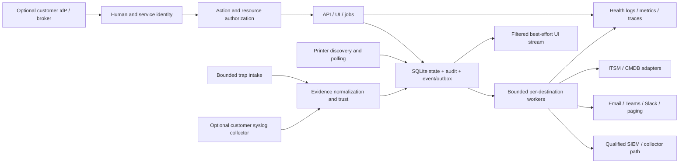

# PrintMarshal: application integration audit and research

Researched **28 October 2026**. Application: `/srv/printmarshal`. Status: **research and recommendations only; no implementation changes**.

PrintMarshal has a useful monitoring foundation: discovery, standards-based printer reads, local identities, jobs, stock tracking, local audit rows and several notification formats. The main enterprise gap is the infrastructure connecting these features to organizational identity, security operations and reliable automation. Adding more destination URLs will not solve missing resource permissions, dropped events or incomplete audit evidence.

This review identifies **18 code findings** and **40 integration work items**. Fourteen findings and 18 work items are P1: address them before enterprise exposure or depending on the affected integration. These priorities indicate delivery order and operational consequences; they are not CVSS ratings and do not imply every missing enterprise feature is a vulnerability.

The strongest implementation sequence is:

1. Fix current session, SMTP deadline, audit and event-routing defects.
2. Establish scoped identities, a canonical event model, transactional audit/outbox and bounded delivery.
3. Qualify SSO, SIEM, printer-log intake, modern email and Teams against actual deployments.
4. Build incident/asset/PKI integrations on those contracts, then consider distributed collectors and optional extensions.

The companion [integration gap register](/srv/printmarshal/research/integration-gap-register-2026-10-28.json) contains every finding, proposal, acceptance criterion, dependency, code anchor and external source in machine-readable form.

## Scope and confidence

This is a **static application and integration audit**: source, configuration, schema, API handlers, event producers, delivery consumers, deployment files and relevant tests were inspected. External research uses official standards, security guidance and vendor documentation. No application build/tests were executed, printers contacted, credentials inspected in runtime stores, notifications sent, accounts provisioned or connectors deployed.

“Implemented” below means a visible code path, not a live compatibility certification. “Missing” means no implementation was found in the inspected application. A catalogue key, interface, enum or placeholder route is not evidence that the capability works. Negative findings are bounded by this source inspection; an external deployment may supply additional reverse proxies or collectors.

The baseline is a self-hosted, single-organization platform. Multiple sites are relevant; full MSP tenant isolation is a separate architecture decision, not something that can be obtained by adding a tenant label. Cloud services and brokers should remain optional. Source hashes and 47 literal code anchors are in the JSON register. The report describes this snapshot and must be revisited as implementation changes.

Prior [printer integration evidence](/srv/printmarshal/research/enterprise-printer-expansion-and-integration-evidence-2026-10-28.md) and the [printer catalogue](/srv/printmarshal/research/enterprise-printer-catalogue-2026-10-28.json) remain relevant for exact model/firmware capabilities. This audit does not promote a researched printer family into a working vendor driver.

## What the application currently supports

| Area | Source-backed state | Enterprise implication |
|---|---|---|
| Fleet discovery and reads | SNMP/IPP reads, discovery, polling, alerts, persisted jobs and stock workflows exist. README describes the early monitoring phases. | A reasonable base for evidence collection; future configuration/security/firmware writes require separate qualification. |
| Human login | Local bcrypt credentials; opaque random sessions stored as hashes; HttpOnly/SameSiteStrict cookies. | Good primitives, with session lifecycle defects below. No enterprise IdP connection. |
| Authorization | Viewer/operator/admin global role hierarchy. | No per-site, per-group, action or integration principal boundaries. |
| REST and browser events | Unversioned REST, manual CSV exports and an authenticated in-memory WebSocket hub. | Useful for the UI; not a durable event subscription or dependable incremental sync contract. |
| Outbound notifications | Startup-configured JSON webhook, Slack, Teams, Discord and SMTP formatters. | Basic delivery paths exist; durability, enterprise authentication and provider qualification are incomplete. |
| Audit and logs | SQLite audit/notification rows; optional JSON operational logs on stdout. | Neither a complete security audit stream nor a SIEM integration. |
| Printer event intake | SNMP trap listener, source-IP association and follow-up poll. | Not equivalent to authenticated, normalized syslog/security-log collection. |
| Secrets | AES-GCM device secret storage; local/env key; SMTP password environment reference. | Connector secrets need consistent references, rotation and backup/key recovery policy. |
| Certificates/security/firmware | Data models and declarations; empty route/service/plugin scaffolding. | No working CA enrollment, certificate rollout or firmware management integration should be advertised. |
| Operations | Single-process SQLite/host-network deployment; static health response. | Fits a small-site starting point; external monitoring, safe TLS deployment and failure diagnostics need work. |

Evidence: [C01: Declared current scope](/srv/printmarshal/README.md:11); [C02: Local authentication and session issuance](/srv/printmarshal/internal/auth/auth.go:78); [C03: Global hierarchical roles](/srv/printmarshal/internal/model/model.go:383); [C11: WebSocket origins and connection lifetime](/srv/printmarshal/internal/api/ws.go:58); [C13: Unbounded asynchronous single-attempt notifications](/srv/printmarshal/internal/alerts/notify.go:51); [C16: Static notifier configuration and declared event choices](/srv/printmarshal/internal/config/config.go:71); [C21: Audit persistence fields](/srv/printmarshal/internal/store/schema.sql:136); [C24: Optional stdout JSON operational logs](/srv/printmarshal/cmd/printmarshal/main.go:55); [C27: Source-address trap trust; no configured SNMPv3 user policy](/srv/printmarshal/internal/trap/listener.go:48); [C31: Security route placeholder](/srv/printmarshal/internal/api/security.go:7); [C32: Firmware route placeholder](/srv/printmarshal/internal/api/firmware.go:7); [C33: Configuration route placeholder](/srv/printmarshal/internal/api/config.go:7); [C34: Empty vendor plugin registration](/srv/printmarshal/internal/plugins/all.go:14); [C35: Single local encryption-key provisioning](/srv/printmarshal/internal/secrets/secrets.go:39); [C44: Small-site host-network deployment](/srv/printmarshal/deploy/docker-compose.yml:8); [C45: SQLite single-connection persistence](/srv/printmarshal/internal/store/sqlite.go:31).

## Code findings

These findings distinguish implementation defects, compatibility risks and missing enterprise features. Existing role/secret tests are useful evidence of intended protections, but do not prove connector resilience or provider compatibility. See [C40: Existing role/secrets coverage](/srv/printmarshal/internal/api/server_test.go:87).

### A01 · P1 · Notification delivery is not durable

**Observed:** Notify launches a goroutine per destination, attempts delivery once, then writes a best-effort notification log. HTTP failures, rate limits and process restarts do not lead to persisted retry.

**Consequence:** SIEM, incident and email events can disappear while the underlying fleet operation succeeds; burst fan-out has no bounded delivery worker.

**Recommended change:** Commit an event/outbox record durably; add bounded workers, destination leases, retry classification, Retry-After, dead letters and replay using stable event IDs.

Code: [C13: Unbounded asynchronous single-attempt notifications](/srv/printmarshal/internal/alerts/notify.go:51); [C14: Generic HTTP delivery without connector credentials/signatures/retries](/srv/printmarshal/internal/alerts/notify.go:86); [C22: Delivery log fields; no retry queue](/srv/printmarshal/internal/store/schema.sql:126).

External basis: [W10: Slack rate limits including webhooks and Retry-After](https://docs.slack.dev/apis/web-api/rate-limits/); [W21: OpenTelemetry Collector resiliency and persistent queues](https://opentelemetry.io/docs/collector/resiliency/).

### A02 · P1 · Declared and delivered event sets differ

**Observed:** Notifier configuration names job.finished, but the job runner emits job.updated only to the Hub. Manual alert clear/ack and consumable replacement events also publish to the Hub without the notifier.

**Consequence:** An incident can remain open externally after an operator clears it, and subscribers can configure an event that is never delivered.

**Recommended change:** Define a single event catalogue and route all eligible transitions through the durable publisher; record automatic versus manual resolution and preserve event origin.

Code: [C16: Static notifier configuration and declared event choices](/srv/printmarshal/internal/config/config.go:71); [C18: Automatic alert notifications](/srv/printmarshal/internal/fleet/service.go:225); [C19: Manual clear broadcasts but does not notify](/srv/printmarshal/internal/api/server.go:765); [C20: Jobs only publish job.updated](/srv/printmarshal/internal/jobs/runner.go:202); [C47: Consumable replacement events only go to event hub](/srv/printmarshal/internal/fleet/service.go:260).

### A03 · P1 · Audit records can be silently lost and omit security context

**Observed:** The API audit helper discards AddAudit errors. Login/logout and middleware denials do not create audit events. Audit rows lack request ID, immutable principal ID, origin IP, principal type and external export state.

**Consequence:** A security team cannot reliably reconstruct access and actions or assume that every recorded change has an audit trail.

**Recommended change:** Make local mutations and audit/outbox atomic; persist intent and outcome separately for future printer I/O; record authentication/denial events with bounded redacted context.

Code: [C04: Authentication and authorization middleware](/srv/printmarshal/internal/api/server.go:127); [C05: Best-effort audit write](/srv/printmarshal/internal/api/server.go:210); [C06: Login response and failure path](/srv/printmarshal/internal/api/server.go:225); [C21: Audit persistence fields](/srv/printmarshal/internal/store/schema.sql:136); [C23: Audit store insertion](/srv/printmarshal/internal/store/sqlite_misc.go:530); [C24: Optional stdout JSON operational logs](/srv/printmarshal/cmd/printmarshal/main.go:55).

External basis: [W07: OWASP Logging Cheat Sheet](https://cheatsheetseries.owasp.org/cheatsheets/Logging_Cheat_Sheet.html).

### A04 · P1 · Password changes preserve old sessions and mint an extra session

**Observed:** changePassword calls Login to verify the current password, causing an additional persisted session whose token is discarded. SetPassword updates only password_hash and does not invalidate other sessions.

**Consequence:** Changing a compromised password does not terminate a stolen bearer session; unused sessions accumulate until expiry or deletion.

**Recommended change:** Separate password verification from session issuance; invalidate or rotate sessions according to explicit policy after password/identity changes and expose administrator revocation.

Code: [C02: Local authentication and session issuance](/srv/printmarshal/internal/auth/auth.go:78); [C07: Password change reuses session-issuing Login](/srv/printmarshal/internal/api/server.go:256); [C08: Password update without session revocation](/srv/printmarshal/internal/store/sqlite_misc.go:657).

External basis: [W05: OWASP Authentication Cheat Sheet](https://cheatsheetseries.owasp.org/cheatsheets/Authentication_Cheat_Sheet.html).

### A05 · P1 · Live streams outlive authorization and accept broad origins

**Observed:** WebSocket authentication occurs at handshake. ServeHTTP allows wildcard origins and never rechecks session expiry or user revocation. TokenFromRequest accepts access_token query parameters for every API request, not just WebSockets.

**Consequence:** A previously authorized stream can continue after logout/deletion/expiry; query tokens can leak through infrastructure URL logging. This is not an unauthenticated WebSocket bypass: authentication and SameSiteStrict cookies still exist.

**Recommended change:** Restrict origins, remove long-lived query tokens, enforce stream revocation/expiry, and later filter events by resource scope.

Code: [C04: Authentication and authorization middleware](/srv/printmarshal/internal/api/server.go:127); [C09: Bearer/cookie/query token extraction](/srv/printmarshal/internal/auth/auth.go:142); [C10: Session cookie attributes](/srv/printmarshal/internal/auth/auth.go:162); [C11: WebSocket origins and connection lifetime](/srv/printmarshal/internal/api/ws.go:58).

External basis: [W02: RFC 9700 OAuth 2.0 Security Best Current Practice](https://www.rfc-editor.org/rfc/rfc9700.html); [W05: OWASP Authentication Cheat Sheet](https://cheatsheetseries.owasp.org/cheatsheets/Authentication_Cheat_Sheet.html).

### A06 · P1 · Enterprise transport and device trust are not configured by default

**Observed:** The server calls ListenAndServe with HTTP; secure cookies default false, and deployment exposes the host-network listener. IPP defaults prefer clear HTTP and enable InsecureSkipVerify for HTTPS reads.

**Consequence:** Credentials require a separately secured ingress; printer identity is not cryptographically verified by default. Read-only polling limits device mutation but does not establish trustworthy telemetry.

**Recommended change:** Document a tested TLS ingress profile and trusted proxy rules; enable secure cookies; add per-connector/device CA bundles or pins and explicit discovery-only trust exceptions.

Code: [C10: Session cookie attributes](/srv/printmarshal/internal/auth/auth.go:162); [C25: HTTP/session/IPP defaults](/srv/printmarshal/internal/config/config.go:112); [C26: Configurable insecure TLS for printer reads](/srv/printmarshal/internal/driver/ipp/driver.go:76); [C41: HTTP server transport and health deployment scope](/srv/printmarshal/cmd/printmarshal/main.go:166); [C44: Small-site host-network deployment](/srv/printmarshal/deploy/docker-compose.yml:8).

External basis: [W05: OWASP Authentication Cheat Sheet](https://cheatsheetseries.owasp.org/cheatsheets/Authentication_Cheat_Sheet.html).

### A07 · P1 · SMTP ignores the notification deadline

**Observed:** Notify creates a 20-second context, but sendMail does not accept it and calls smtp.Dial with no application connection/read/write deadline.

**Consequence:** Unresponsive SMTP servers can retain goroutines beyond the intended timeout and make shutdown/delivery health unreliable.

**Recommended change:** Use context-aware dialing and per-phase socket deadlines, bounded email workers, validated headers and explicit TLS modes.

Code: [C13: Unbounded asynchronous single-attempt notifications](/srv/printmarshal/internal/alerts/notify.go:51); [C15: SMTP PLAIN, STARTTLS option and missing deadline](/srv/printmarshal/internal/alerts/notify.go:107).

### A08 · P1 · SMTP authentication has no modern provider route

**Observed:** Only smtp.PlainAuth is implemented. There is no XOAUTH2 token acquisition, Graph sendMail or connector credential lifecycle.

**Consequence:** Modern Microsoft 365 policies and other OAuth-only deployments cannot use this path directly; it still works with a compatible local relay.

**Recommended change:** Keep local SMTP/relay support and add OAuth SMTP or scoped Graph sending. Treat provider acceptance separately from mailbox delivery.

Code: [C15: SMTP PLAIN, STARTTLS option and missing deadline](/srv/printmarshal/internal/alerts/notify.go:107); [C16: Static notifier configuration and declared event choices](/srv/printmarshal/internal/config/config.go:71).

External basis: [W13: Exchange SMTP AUTH revised timeline, January 27 2026](https://techcommunity.microsoft.com/blog/exchange/updated-exchange-online-smtp-auth-basic-authentication-deprecation-timeline/4489835); [W14: Microsoft SMTP OAuth / XOAUTH2 and application permissions](https://learn.microsoft.com/en-us/exchange/client-developer/legacy-protocols/how-to-authenticate-an-imap-pop-smtp-application-by-using-oauth); [W15: Microsoft Graph sendMail](https://learn.microsoft.com/en-us/graph/api/user-sendmail?tabs=python&view=graph-rest-1.0); [W16: Exchange application RBAC for mailbox scope](https://learn.microsoft.com/en-us/exchange/permissions-exo/application-rbac).

### A09 · P1 · Teams compatibility needs a Workflows migration contract

**Observed:** The Teams formatter posts a MessageCard with no configurable HTTP authorization header or documented Workflow authentication/ownership setup.

**Consequence:** Old Office 365 Connector URLs are retired. MessageCard itself is not universally invalid: current Workflows supports rendering it, with limitations.

**Recommended change:** Document and test Workflows endpoints, authentication and supported card schemas; use Adaptive Cards for interactive flows and handle expired endpoints/owner changes.

Code: [C14: Generic HTTP delivery without connector credentials/signatures/retries](/srv/printmarshal/internal/alerts/notify.go:86); [C16: Static notifier configuration and declared event choices](/srv/printmarshal/internal/config/config.go:71).

External basis: [W11: Teams connector retirement, April 14 2026 update](https://devblogs.microsoft.com/microsoft365dev/retirement-of-office-365-connectors-within-microsoft-teams/); [W12: Teams Workflows webhook authentication and payload schemas](https://learn.microsoft.com/en-us/connectors/teams/).

### A10 · P1 · Authentication and machine identity are local-only

**Observed:** Auth supports local bcrypt users and opaque sessions. There are no OIDC/SAML/SCIM routes, identity-provider mappings, MFA assurance handling or first-class scoped service accounts.

**Consequence:** Enterprise lifecycle, conditional access and automation must rely on separately managed local users or human sessions.

**Recommended change:** Implement generic OIDC and separate service principals first; use a broker for SAML/LDAP where suitable; retain controlled local recovery access; add SCIM for lifecycle.

Code: [C02: Local authentication and session issuance](/srv/printmarshal/internal/auth/auth.go:78); [C04: Authentication and authorization middleware](/srv/printmarshal/internal/api/server.go:127); [C06: Login response and failure path](/srv/printmarshal/internal/api/server.go:225); [C09: Bearer/cookie/query token extraction](/srv/printmarshal/internal/auth/auth.go:142).

External basis: [W01: OpenID Connect Core 1.0, errata set 2](https://openid.net/specs/openid-connect-core-1_0.html); [W02: RFC 9700 OAuth 2.0 Security Best Current Practice](https://www.rfc-editor.org/rfc/rfc9700.html); [W03: RFC 7644 SCIM protocol](https://www.rfc-editor.org/rfc/rfc7644.html); [W04: Keycloak identity brokering and user federation](https://www.keycloak.org/docs/latest/server_admin/).

### A11 · P1 · Authorization is global and coarse

**Observed:** Role.Allows is a three-level rank. require only checks that rank. Existing groups and credential scopes route fleet work but do not constrain which resources a user can read or change.

**Consequence:** A site operator or integration cannot be limited to a site/group/action; global streams and exports share that boundary.

**Recommended change:** Add action/resource policy checks across list, single-object, export, bulk jobs, streams and credentials. Separate security/firmware permissions and approval roles before writes ship.

Code: [C03: Global hierarchical roles](/srv/printmarshal/internal/model/model.go:383); [C04: Authentication and authorization middleware](/srv/printmarshal/internal/api/server.go:127); [C37: API query/filter surface](/srv/printmarshal/internal/api/server.go:301); [C38: Device/group credential routing, not human authorization](/srv/printmarshal/internal/store/sqlite_misc.go:69).

External basis: [W06: OWASP Authorization Cheat Sheet](https://cheatsheetseries.owasp.org/cheatsheets/Authorization_Cheat_Sheet.html).

### A12 · P1 · SIEM export and printer-log ingestion are absent

**Observed:** There is no SIEM exporter, syslog receiver, OTLP receiver/exporter or normalized device-security log store. The security.syslog.server catalogue entry describes a future printer setting, not a running receiver.

**Consequence:** Application audit export, printer security collection and operational telemetry cannot be treated as existing end-to-end integrations.

**Recommended change:** Implement separate pipelines with common identity/correlation; support a qualified external collector before building a general log-storage product.

Code: [C21: Audit persistence fields](/srv/printmarshal/internal/store/schema.sql:136); [C24: Optional stdout JSON operational logs](/srv/printmarshal/cmd/printmarshal/main.go:55); [C27: Source-address trap trust; no configured SNMPv3 user policy](/srv/printmarshal/internal/trap/listener.go:48); [C29: Certificate protocol declarations](/srv/printmarshal/internal/model/security.go:91); [C30: Syslog setting declaration](/srv/printmarshal/internal/model/settings_catalog.go:84); [C31: Security route placeholder](/srv/printmarshal/internal/api/security.go:7).

External basis: [W17: RFC 5424 Syslog](https://www.rfc-editor.org/info/rfc5424/); [W18: RFC 5425 Syslog over TLS](https://www.rfc-editor.org/info/rfc5425/); [W20: OpenTelemetry OTLP specification](https://opentelemetry.io/docs/specs/otlp/); [W24: Azure Monitor Logs Ingestion API / DCR configuration](https://learn.microsoft.com/en-us/azure/azure-monitor/logs/logs-ingestion-api-overview); [W25: Microsoft Sentinel syslog/CEF via AMA](https://learn.microsoft.com/en-us/azure/sentinel/cef-syslog-ama-overview).

### A13 · P1 · Trap attribution and storm controls are incomplete

**Observed:** The listener uses gosnmp.Default, clears the community restriction and matches devices by source IP. No application SNMPv3 trap-user configuration or rate/coalescing policy is visible. A matched trap can raise an alert and submit a poll.

**Consequence:** Spoofed or burst events on reachable networks can contaminate evidence and induce extra poll/notification work; SNMP polling v3 support does not prove authenticated trap reception.

**Recommended change:** Provide source policies, configured v3 security where supported, trust labels, bounded input/rate limits and coalesced reconciliation; never execute remediation based only on an untrusted log/trap.

Code: [C27: Source-address trap trust; no configured SNMPv3 user policy](/srv/printmarshal/internal/trap/listener.go:48); [C28: Trap alert creation and reconciliation poll submission](/srv/printmarshal/internal/fleet/service.go:529).

### A14 · P2 · Integration secrets lack managed rotation and references

**Observed:** Device secrets use AES-GCM and a single operator-supplied or generated key. Webhook URLs are config-file values; SMTP references an environment variable. There is no connector secret reference abstraction or key version/rotation workflow.

**Consequence:** Webhook URLs themselves are bearer secrets; enterprise secret stores and key rotation cannot be connected consistently.

**Recommended change:** Add secretRef resolution with minimum privileges, versioned key handling and rotation tests; support mounted files first and optional Vault/managed secret backends.

Code: [C16: Static notifier configuration and declared event choices](/srv/printmarshal/internal/config/config.go:71); [C35: Single local encryption-key provisioning](/srv/printmarshal/internal/secrets/secrets.go:39); [C38: Device/group credential routing, not human authorization](/srv/printmarshal/internal/store/sqlite_misc.go:69).

External basis: [W34: Vault KV v2 API](https://developer.hashicorp.com/vault/api-docs/secret/kv/kv-v2).

### A15 · P2 · REST export is not a stable incremental sync contract

**Observed:** Routes are unversioned and deviceFilter has no updated-since cursor. listDevices reports total as len(returned devices), including when a limit applies. No OpenAPI contract, idempotency-key flow or dedicated integration API credentials were found.

**Consequence:** CMDB/ITSM automation needs custom polling and can misinterpret a page count as a collection total or duplicate actions after retries.

**Recommended change:** Publish a versioned OpenAPI contract with accurate pagination, cursors/tombstones, external IDs, conflict rules, request IDs and idempotent command submission.

Code: [C04: Authentication and authorization middleware](/srv/printmarshal/internal/api/server.go:127); [C36: API result total equals returned page length](/srv/printmarshal/internal/api/server.go:314); [C37: API query/filter surface](/srv/printmarshal/internal/api/server.go:301); [C43: Audit and notification API access](/srv/printmarshal/internal/api/server.go:111).

External basis: [W41: OpenAPI Specification 3.2.1](https://spec.openapis.org/oas/v3.2.1.html).

### A16 · P2 · Application health has little external instrumentation

**Observed:** JSON slog is optional, HTTP access logging is debug-level, and /healthz returns a static OK/version response. No Prometheus endpoint or OpenTelemetry instrumentation was found.

**Consequence:** Operators cannot see delivery backlog age, failed exports, DB readiness, scheduler lag or stale fleet data using their existing observability stack.

**Recommended change:** Add readiness and metrics first, then OTLP correlation. Keep device telemetry/metrics distinct from immutable audit delivery and constrain label cardinality.

Code: [C24: Optional stdout JSON operational logs](/srv/printmarshal/cmd/printmarshal/main.go:55); [C39: Telemetry pruning but no integration/audit lifecycle worker](/srv/printmarshal/internal/fleet/service.go:469); [C41: HTTP server transport and health deployment scope](/srv/printmarshal/cmd/printmarshal/main.go:166).

External basis: [W20: OpenTelemetry OTLP specification](https://opentelemetry.io/docs/specs/otlp/); [W21: OpenTelemetry Collector resiliency and persistent queues](https://opentelemetry.io/docs/collector/resiliency/); [W28: Prometheus instrumentation/cardinality practices](https://prometheus.io/docs/practices/instrumentation/).

### A17 · P2 · PKI/configuration/firmware interfaces are scaffolding

**Observed:** SCEP/EST/ACME enums and CAProfile exist, but the three feature route files are empty, service facades do not implement the workflows, and vendor plugin registration is empty.

**Consequence:** Certificate enrollment, policy-remediation or signed firmware integrations cannot be advertised based on type names or schemas.

**Recommended change:** Build CA-provider and printer-install adapters with separate compatibility records, and place all device writes behind capability, approval and audit controls.

Code: [C29: Certificate protocol declarations](/srv/printmarshal/internal/model/security.go:91); [C31: Security route placeholder](/srv/printmarshal/internal/api/security.go:7); [C32: Firmware route placeholder](/srv/printmarshal/internal/api/firmware.go:7); [C33: Configuration route placeholder](/srv/printmarshal/internal/api/config.go:7); [C34: Empty vendor plugin registration](/srv/printmarshal/internal/plugins/all.go:14).

External basis: [W35: Vault PKI API / issuance and CSR signing](https://developer.hashicorp.com/vault/api-docs/secret/pki).

### A18 · P1 · Generated bootstrap password is written into ordinary logs

**Observed:** When no initial password is provided, Bootstrap logs the generated password in a warning event on the application's normal logger.

**Consequence:** Shipping stdout wholesale to a SIEM can copy the initial administrator credential into a broader-access log system.

**Recommended change:** Use a protected bootstrap handoff or supply the existing environment setting; explicitly prevent bootstrap secret fields from reaching centralized logs and verify redaction.

Code: [C24: Optional stdout JSON operational logs](/srv/printmarshal/cmd/printmarshal/main.go:55); [C42: Generated bootstrap password deliberately logged](/srv/printmarshal/internal/auth/auth.go:41).

External basis: [W07: OWASP Logging Cheat Sheet](https://cheatsheetseries.owasp.org/cheatsheets/Logging_Cheat_Sheet.html).

## Integration design

### Keep identity planes separate

PrintMarshal needs several distinct identities. Sharing a local administrator session across these planes creates unnecessary authority and makes audit attribution ambiguous.

| Identity plane | Proposed mechanism | Authority boundary |
|---|---|---|
| Human operator | OIDC login; local recovery access under explicit policy | Local action/resource authorization still applies after IdP authentication. |
| Automated API client | First-class service principal with revocable scoped credentials, or validated audience-specific OAuth access token | Inventory reader, incident updater and future campaign executor are different permissions. |
| Printer management | Existing scoped SNMP/device credentials, later exact vendor credentials and device certificates | A credential matching a group is not permission for a human to operate that group. |
| Outbound connector | Separate provider token, webhook secret, SMTP identity or client certificate | A connector may deliver events; it does not inherit administrator authority. |
| Site collector | Installation/site-bound mTLS identity | A collector may submit evidence for its assigned site; it cannot impersonate an arbitrary operator. |
| Certificate authority client | Restricted enrollment/signing identity and key custody policy | Successful issuance is separate from successful installation on a printer. |

**OIDC first.** Use the server-side authorization-code flow with PKCE, issuer discovery, signing-key rotation, signature/issuer/audience/expiry checks and appropriate state/nonce protections. Store the stable identity as **issuer + subject**, not email. A recycled address must not inherit another person's permissions. Map IdP groups to local roles/scopes explicitly and deny unexpected mappings. MFA/conditional access belong primarily to the IdP; define which assurance claims and session ages privileged actions require. An ID token is not a general-purpose API access token. [W01: OpenID Connect Core 1.0, errata set 2](https://openid.net/specs/openid-connect-core-1_0.html); [W02: RFC 9700 OAuth 2.0 Security Best Current Practice](https://www.rfc-editor.org/rfc/rfc9700.html).

Target generic OIDC interoperability with customer-selected providers such as Entra ID, Okta or Keycloak; these are **qualification targets**, not tested PrintMarshal integrations. Where a customer requires SAML or LDAP/AD, an optional broker is a practical route to the same OIDC boundary. Keycloak documents identity brokering and user federation. Native SAML and direct LDAP would add separate parsing, trust and credential-handling responsibilities and should follow demonstrated requirements. [W04: Keycloak identity brokering and user federation](https://www.keycloak.org/docs/latest/server_admin/).

**Provisioning is separate from login.** SCIM Users/Groups and deactivation can manage lifecycle; account disable/group removal must revoke local sessions and streams within a published bound. JIT OIDC creation alone is not offboarding. Keep stable external IDs, explicit field ownership and idempotent retries. A SCIM bearer credential needs its own restricted principal and audit trail. [W03: RFC 7644 SCIM protocol](https://www.rfc-editor.org/rfc/rfc7644.html).

**Authorization must cover every access path.** Introduce action/resource checks for list results, direct IDs, exports, telemetry, credentials, bulk jobs and WebSockets. Evaluate bulk targets at submission and execution. A dynamic group or externally imported location must not silently expand a principal's rights. Future security/firmware actions need separate permissions and approval/execution roles; successful login is insufficient. Credential routing already present in the store must remain separate from these decisions. [C03: Global hierarchical roles](/srv/printmarshal/internal/model/model.go:383); [C04: Authentication and authorization middleware](/srv/printmarshal/internal/api/server.go:127); [C38: Device/group credential routing, not human authorization](/srv/printmarshal/internal/store/sqlite_misc.go:69); [W06: OWASP Authorization Cheat Sheet](https://cheatsheetseries.owasp.org/cheatsheets/Authorization_Cheat_Sheet.html).

### Establish one event contract and durable delivery

The current browser hub and notifier are different paths. The hub drops on full subscriber buffers; it has no replay cursor. Notifier goroutines attempt delivery once. Neither should serve as the security-event system of record. Keep the UI stream responsive, but drive durable integrations from persisted canonical events. [C12: In-memory event broadcast with drop-on-full](/srv/printmarshal/internal/api/ws.go:25); [C13: Unbounded asynchronous single-attempt notifications](/srv/printmarshal/internal/alerts/notify.go:51); [C17: Event envelope without stable event ID/schema version](/srv/printmarshal/internal/model/model.go:552); [C22: Delivery log fields; no retry queue](/srv/printmarshal/internal/store/schema.sql:126).

A suitable first design is a **SQLite event/outbox transaction and a bounded worker pool**. A local state transition, its audit record and eligible outbox entries should commit together. Keep separate immutable source events, destination delivery state and delivery attempts. Preserve original event ID/time through retries, schema transformations and replay. Record provider acceptance separately from later indexing or inbox delivery. The reliability target is **at-least-once delivery with receiver deduplication**, within explicit retention/capacity limits.

This does not make a physical printer operation transactional with SQLite. For future writes: persist authorized intent, perform device I/O, then persist a verified outcome. A network timeout may mean **unknown**, requiring reconciliation. Never infer rollback or success merely from an HTTP timeout.

A CloudEvents-compatible envelope is a sensible external contract, alongside a versioned PrintMarshal payload schema. CloudEvents specifies required context fields; its `specversion` is `"1.0"` even when using the published 1.0.2 specification. The example below is a **proposal**, not an existing API. [W08: CloudEvents 1.0.2 event specification](https://github.com/cloudevents/spec/blob/v1.0.2/cloudevents/spec.md).

```json
{
  "specversion": "1.0",
  "id": "evt_example_001",
  "source": "urn:printmarshal:installation:example",
  "type": "com.printmarshal.alert.raised.v1",
  "subject": "devices/device_123/alerts/alert_456",
  "time": "2026-10-28T18:00:00Z",
  "datacontenttype": "application/json",
  "dataschema": "urn:printmarshal:schema:alert-event:1",
  "data": {
    "observed_at": "2026-10-28T18:00:00Z",
    "device_reported_at": null,
    "actor": { "kind": "unknown" },
    "observer": { "kind": "application", "id": "installation_example" },
    "resource": { "device_id": "device_123", "site_id": "site_01" },
    "correlation_id": "correlation_example_001",
    "alert_incarnation_id": "alert_456_occurrence_01",
    "origin": "printer_trap",
    "trust": {
      "transport": "snmp_v2c_udp",
      "attribution": "source_ip_only",
      "verified_device_identity": false
    }
  }
}
```

Define whether `time` is a trustworthy occurrence time or observation time, and retain both device-reported and receipt times where available. A collector identity proves the observer's identity, not automatically the printer's or the human actor's.

Minimum event coverage should include authentication success/failure, denied access, identity/permission/secret changes, device discovery/freshness changes, alert raise/ack/clear/reopen, job terminal outcomes, stock thresholds and future certificate/configuration/firmware intent/results. Give each advertised event an actual producer. A firmware version observed by polling is not the same event as a verified firmware update performed by PrintMarshal.

Workers need destination isolation, bounded concurrency, jittered backoff, `Retry-After`, retry budgets, dead letters, authorized replay and visible oldest-queue age. Avoid retrying permanent schema/authentication errors forever. An ambiguous response may require deduplication even when the sender did not see success. Persistent collector queues help after handoff; they cannot recover an application event that was never emitted. [W10: Slack rate limits including webhooks and Retry-After](https://docs.slack.dev/apis/web-api/rate-limits/); [W20: OpenTelemetry OTLP specification](https://opentelemetry.io/docs/specs/otlp/); [W21: OpenTelemetry Collector resiliency and persistent queues](https://opentelemetry.io/docs/collector/resiliency/).

Queue capacity, disk-full admission policy, backup consistency and SQLite synchronization settings must be specified and tested before making power-loss durability claims. Network TLS/TCP and a local queue do not establish end-to-end exactly-once delivery.

### Use a small-site architecture first



This requires no mandatory Kafka cluster, external identity broker or hosted service. Preserve offline operation with local login/recovery policy, local relay, cached advisories and approved manual packages. Add an optional collector, secret backend or message bus only where topology, load or customer policy justifies it. External integrations should fail visibly without stopping unrelated printer monitoring.


## SIEM, printer-log ingestion and observability are three different flows

| Flow | Origin and purpose | Proposed path | Essential semantics |
|---|---|---|---|
| Application security/audit export | PrintMarshal identities, authorizations and actions | Transactional audit/outbox → qualified SIEM adapter or customer collector | Immutable principal/event IDs, action/outcome, resource scope, redaction, delivery evidence. |
| Printer-origin security/event ingestion | Printer syslog/traps and vendor-specific events | Bounded intake/collector → normalization and evidence attribution → selected alerts/export | Source trust, raw evidence reference, parser/model/firmware coverage, occurrence/receipt time, loss limitations. |
| Application health telemetry | API, scheduler, drivers, DB and connector workers | Structured logs + Prometheus metrics + optional OTLP traces/logs | Request/job correlation, backlog/failure signals, cardinality controls, nonblocking instrumentation. |

A stdout log forwarder does not repair missing audit events. A syslog receiver does not create normalized printer security semantics. OTLP transports telemetry but does not by itself supply an ECS mapping, a Sentinel table schema or a tested detection rule.

### Application security export and SIEM options

Record security events independently of debug/access logs. Include immutable actor/principal type, local/external identity reference, action, target, site, result, request/correlation/job IDs, timestamp and trusted source attribution. Record denials and failures, not just successful changes. Sanitize attacker-controlled text and omit passwords, session tokens, device communities, SMTP credentials and full webhook URLs. The current bootstrap warning is a concrete reason to review log fields **before** forwarding stdout centrally. [C05: Best-effort audit write](/srv/printmarshal/internal/api/server.go:210); [C06: Login response and failure path](/srv/printmarshal/internal/api/server.go:225); [C21: Audit persistence fields](/srv/printmarshal/internal/store/schema.sql:136); [C24: Optional stdout JSON operational logs](/srv/printmarshal/cmd/printmarshal/main.go:55); [C42: Generated bootstrap password deliberately logged](/srv/printmarshal/internal/auth/auth.go:41); [W07: OWASP Logging Cheat Sheet](https://cheatsheetseries.owasp.org/cheatsheets/Logging_Cheat_Sheet.html).

| Destination | Working integration contract to implement or qualify | Important qualification |
|---|---|---|
| Customer collector / generic JSON | Versioned JSON events and a documented authenticated handoff, or structured stdout as a transitional operational path | The collector's own persistence does not make current best-effort audit writes reliable. Distinguish source commit, handoff and backend ingestion. |
| RFC 5424 syslog over TLS | Correct message framing, severity mapping, structured data and CA validation; modern TLS profile | RFC 5425 transport is not application-level indexing acknowledgment. RFC 9662 updates old cipher requirements; do not copy a 2009 cipher profile unchanged. |
| Splunk HEC | HEC authorization and envelope, index/sourcetype/source/time mapping, batching and response parsing | Generic webhook JSON lacks this contract. Indexer acknowledgment requires supported deployment/configuration and acknowledgment tracking; qualify Splunk Enterprise/Cloud separately. |
| Microsoft Sentinel, direct API | Azure Monitor Logs Ingestion API, OAuth identity, DCR/table mapping and appropriate DCR-scoped permissions | A Data Collection Endpoint is needed in some configurations, including relevant Private Link/older-DCR cases; it is not universally required. The current API requires TLS 1.2 or later. |
| Microsoft Sentinel, syslog/CEF | Supported forwarder with Azure Monitor Agent and a matching DCR | This is a different architecture from custom-table API ingestion. Map received/device time and avoid collecting the same stream twice unintentionally. |
| Elastic Security | ECS mapping with valid timestamps, event classification and required security fields | Accepting raw JSON or OTLP is not proof the event is usable in Elastic Security. Publish/test an ingest pipeline and sample queries. |
| Other SIEM/log platforms | Qualified customer collector plus documented mapping first | Name the tested backend/version/schema and supported acknowledgment level before claiming support. |

Sources: [W17: RFC 5424 Syslog](https://www.rfc-editor.org/info/rfc5424/); [W18: RFC 5425 Syslog over TLS](https://www.rfc-editor.org/info/rfc5425/); [W19: RFC 9662 updated secure-syslog cipher requirements](https://www.rfc-editor.org/rfc/rfc9662.html); [W22: Splunk HEC request examples](https://help.splunk.com/en/splunk-enterprise/get-data-in/collect-http-event-data/http-event-collector-examples); [W23: Splunk HEC indexer acknowledgment and platform caveats](https://help.splunk.com/en/splunk-enterprise/get-started/get-data-in/9.0/get-data-with-http-event-collector/about-http-event-collector-indexer-acknowledgment); [W24: Azure Monitor Logs Ingestion API / DCR configuration](https://learn.microsoft.com/en-us/azure/azure-monitor/logs/logs-ingestion-api-overview); [W25: Microsoft Sentinel syslog/CEF via AMA](https://learn.microsoft.com/en-us/azure/sentinel/cef-syslog-ama-overview); [W26: Elastic ECS event fields](https://www.elastic.co/docs/reference/ecs/ecs-event); [W27: Elastic Security required ECS fields](https://www.elastic.co/docs/reference/security/fields-and-object-schemas/siem-field-reference).

Start with one canonical audit schema and one qualified handoff, then prioritize direct adapters from customer demand. For every backend, retain the PrintMarshal event ID and separate original, created/observed and ingestion timestamps. Include a sample search proving a failed login, denied operation and future device-write result are searchable with their correlation chain. A successful HTTP exchange alone is insufficient evidence.

### Printer syslog and trap ingestion

There is currently a trap listener but no working syslog collection pipeline. The `security.syslog.server` setting is a declaration about printer configuration, not a running log server or proof that PrintMarshal can change a printer's syslog destination. [C27: Source-address trap trust; no configured SNMPv3 user policy](/srv/printmarshal/internal/trap/listener.go:48); [C28: Trap alert creation and reconciliation poll submission](/srv/printmarshal/internal/fleet/service.go:529); [C30: Syslog setting declaration](/srv/printmarshal/internal/model/settings_catalog.go:84); [C31: Security route placeholder](/srv/printmarshal/internal/api/security.go:7).

Prefer an **optional customer-operated syslog collector** initially, such as a qualified rsyslog deployment with TCP/TLS intake, explicit spool/queue settings and authenticated forwarding into PrintMarshal. This isolates high-volume parsing and network privilege requirements from the API process. An adapter should accept normalized records with stable source identity, site, transport, raw evidence reference and parser version. Keep raw retention bounded and configurable; PrintMarshal should link useful evidence rather than attempt to replace the organization's SIEM. [W43: rsyslog TCP/TLS intake](https://docs.rsyslog.com/doc/configuration/modules/imtcp.html); [W44: rsyslog queue durability distinctions](https://docs.rsyslog.com/doc/concepts/queues.html).

Do not call all disk-assisted queues crash durable: queue mode, synchronization and checkpoint policy matter. Likewise, legacy UDP cannot promise delivery. A trusted TLS hop from a collector does not retroactively authenticate the printer that sent it UDP. Preserve an explicit trust class such as authenticated device transport, approved collector with legacy source, source-IP-only, or unknown.

Maintain parser coverage per vendor/model/firmware using captured, sanitized fixtures. Investigate login failure, administrative login, configuration/certificate change, reboot and firmware/security events where devices actually expose them. Unknown formats must remain unknown evidence; a guessed parse must not become an assertion of compromise or compliance.

For traps, configure source policy, supported SNMPv3 security users and engine/time handling rather than inferring authenticated reception from v3 polling support. Label the existing source-IP association as weak identity evidence. Coalesce trap-triggered polls, bound source rates/queue sizes, and measure drops. The existing follow-up poll is useful corroboration, but neither a trap nor a log should directly authorize a future firmware action, credential change or quarantine.

### Health telemetry and external monitoring

Expose separate process liveness and readiness. Readiness should reveal DB availability and important local capacity failures; connector-specific status should expose backlog/disk age and failures without taking the whole application out of service solely because a remote SMTP destination is offline. The current static health endpoint does not offer this distinction. [C39: Telemetry pruning but no integration/audit lifecycle worker](/srv/printmarshal/internal/fleet/service.go:469); [C41: HTTP server transport and health deployment scope](/srv/printmarshal/cmd/printmarshal/main.go:166).

Recommended measurements include poll freshness, queued/running jobs, scheduler lag, driver latency/error class, event acceptance/drop counts, outbox depth/oldest age, attempts by outcome, dead letters, trap/log parser failures, disk capacity and secret-resolution errors. Avoid embedding tokens or uncontrolled device text in metrics.

Prometheus should cover operational metrics first. Per-device fleet metrics can be opt-in with explicit cardinality budgets rather than labels containing arbitrary addresses, serials or messages everywhere. Add OTLP tracing/log correlation across request → job → driver → connector when the basics are dependable. Define authentication for metrics and collector transport, and handle OTLP partial-success/rejected-record responses; HTTP success need not mean every record was accepted. [W28: Prometheus instrumentation/cardinality practices](https://prometheus.io/docs/practices/instrumentation/); [W20: OpenTelemetry OTLP specification](https://opentelemetry.io/docs/specs/otlp/); [W21: OpenTelemetry Collector resiliency and persistent queues](https://opentelemetry.io/docs/collector/resiliency/).

Existing network-monitoring estates can poll a versioned PrintMarshal API using a read-only principal. Zabbix HTTP agent is one possible external bridge; this would need a qualified template and does not mean PrintMarshal has native Zabbix support today. [W45: Zabbix HTTP agent API polling](https://www.zabbix.com/documentation/7.2/en/manual/config/items/itemtypes/http).

## Email, webhooks and collaboration

### Email: local relay plus a modern provider route

Keep on-premises SMTP relays viable. Fix the current missing connection/read/write deadlines before undertaking a larger integration rewrite; this small defect does not need to wait for every outbox dependency. Provide explicit STARTTLS-required, implicit-TLS and narrowly approved relay modes, verified server names/CAs, safe MIME encoding and CR/LF validation for all headers. A printer's supplied name/description is untrusted text.

The present use of Go's `smtp.PlainAuth` should **not** be described as automatically transmitting passwords over arbitrary cleartext links: that implementation rejects non-TLS use except localhost. The actual findings are ineffective deadlines, limited authentication choices and incomplete connector policy. [W47: Go smtp.PlainAuth source](https://go.dev/src/net/smtp/auth.go). [C13: Unbounded asynchronous single-attempt notifications](/srv/printmarshal/internal/alerts/notify.go:51); [C15: SMTP PLAIN, STARTTLS option and missing deadline](/srv/printmarshal/internal/alerts/notify.go:107); [C16: Static notifier configuration and declared event choices](/srv/printmarshal/internal/config/config.go:71).

Microsoft's **27 January 2026 revised SMTP AUTH announcement** supersedes older March/April removal claims: behavior remains unchanged through December 2026; at the end of December it is disabled by default for existing tenants, with an administrator re-enable route, and new tenants created after December 2026 use OAuth by default. Microsoft says it will announce the final removal date in the second half of 2027. Tenant security policy may already disallow password SMTP. [W13: Exchange SMTP AUTH revised timeline, January 27 2026](https://techcommunity.microsoft.com/blog/exchange/updated-exchange-online-smtp-auth-basic-authentication-deprecation-timeline/4489835).

Support either XOAUTH2 SMTP with appropriate application permissions/token lifecycle, or Graph `sendMail`; choose by customer policy rather than treating one as universal. Scope the sending identity/mailbox and test the actual authorization combination: broad Entra application grants and Exchange application RBAC grants can be additive. Graph acceptance is not proof of inbox delivery. [W14: Microsoft SMTP OAuth / XOAUTH2 and application permissions](https://learn.microsoft.com/en-us/exchange/client-developer/legacy-protocols/how-to-authenticate-an-imap-pop-smtp-application-by-using-oauth); [W15: Microsoft Graph sendMail](https://learn.microsoft.com/en-us/graph/api/user-sendmail?tabs=python&view=graph-rest-1.0); [W16: Exchange application RBAC for mailbox scope](https://learn.microsoft.com/en-us/exchange/permissions-exo/application-rbac).

Track transient versus permanent failures, retries and provider message references where available. Optional bounce/delivery feedback is a separate inbound integration. Notifications and scheduled reports should avoid sending device credentials or overly broad fleet exports to distribution lists.

### Outbound and inbound webhooks

Outbound delivery should support a versioned schema, stable event ID, configurable header-based authentication, HMAC signatures with key IDs, timestamp/replay handling and secret rotation. Sign the exact transmitted bytes; receiver examples should use constant-time verification. GitHub's HMAC validation documentation is a useful pattern; the proposed timestamp/replay protocol is a PrintMarshal design choice, not a claim that all webhook providers share one standard. [W09: GitHub webhook HMAC signature validation](https://docs.github.com/en/webhooks/using-webhooks/validating-webhook-deliveries).

Set request/body/response limits, TLS and destination policies, redirect rules and per-connector timeout/retry budgets. Internal RFC1918 destinations are legitimate in this self-hosted product. Use administratively approved destination policies, revalidate redirects/DNS according to that policy, protect metadata/local control endpoints and avoid credential forwarding to another host. A blanket ban on all private addresses would defeat on-premises ITSM and SIEM use cases.

Inbound callbacks need their **own** scoped authentication, replay/dedup protection, object correlation and allowed transition mapping. A signed incident callback may acknowledge an authorized alert; it must not acquire permission to update firmware or execute arbitrary commands. Record origin/correlation markers to prevent PrintMarshal ↔ ticketing loops, and separate “external ticket resolved” from “printer condition verified clear.”

### Teams, Slack, Discord and on-call

The existing Teams formatter is not enough to claim current compatibility. Microsoft's updated notice set Office 365 Connector retirement for **18–22 May 2026**. Move qualification to **Teams Workflows**: establish endpoint ownership, authentication mode, tenant restrictions, supported payload and recovery after owner changes. Workflows can render MessageCard content; its interactive button limitations are why Adaptive Cards may be needed. The report therefore does not label every MessageCard payload inherently broken. [W11: Teams connector retirement, April 14 2026 update](https://devblogs.microsoft.com/microsoft365dev/retirement-of-office-365-connectors-within-microsoft-teams/); [W12: Teams Workflows webhook authentication and payload schemas](https://learn.microsoft.com/en-us/connectors/teams/).

Slack/Discord endpoints also need credential redaction, rate-limit handling and tested schemas. Do not apply one provider's limits or response interpretation to another. Queue isolation and `Retry-After` support matter during a printer storm. [W10: Slack rate limits including webhooks and Retry-After](https://docs.slack.dev/apis/web-api/rate-limits/).

PagerDuty merits an explicit alert lifecycle adapter, not generic HTTP fan-out: trigger/acknowledge/resolve, a stable `dedup_key` per alert incarnation, severity/routing policy and deliberate reopen semantics. An accepted asynchronous request, a rate limit and an ambiguous failure have different consequences. Routine low-stock events should normally create a digest/ticket rather than page the on-call engineer. [W29: PagerDuty Events API v2 overview and retry semantics](https://docs.pagerduty.com/developer/events-api-v2-overview); [W46: PagerDuty alert event parameters and deduplication](https://docs.pagerduty.com/developer/send-alert-event).


## Additional integrations that fit the product

### ITSM, asset inventory and field ownership

ServiceNow and Jira Service Management fit printer incidents, dispatch and change linkage. Start with one-way create/update/resolve plus external object IDs and idempotency. Add inbound acknowledgment only after scoped callback authorization exists. Do not automatically treat ticket closure as verified printer recovery.

For Jira Service Management, the request API needs a service desk, request type, applicable fields and appropriate permissions. ServiceNow **CMDB writes** should use Identification and Reconciliation rather than blind row creation; incident/ticket updates are a separate adapter and lifecycle. [W30: ServiceNow Identification and Reconciliation REST API](https://www.servicenow.com/docs/r/api-reference/rest-apis/c_IdentifyReconcileAPI.html); [W31: Jira Service Management create request API](https://developer.atlassian.com/cloud/jira/service-desk/rest/api-group-request/).

NetBox/Snipe-IT and other customer inventories are good enrichment/sync targets. Build a qualified mapping/bridge before claiming native support. Use stable device evidence, installation/site identity and external IDs; IP address alone is not a durable primary key. Deal with replacements, changing addresses, duplicate serials, missing serials and devices discovered through multiple protocols. [W32: NetBox stable REST API documentation](https://netbox.readthedocs.io/en/stable/integrations/rest-api/); [W33: Snipe-IT API overview](https://snipe-it.readme.io/reference/api-overview).

| Data | Suggested authority | Conflict behavior |
|---|---|---|
| Observed model, serial evidence, firmware component versions, reachability and supplies | PrintMarshal observations with timestamp/confidence | Retain conflicting evidence; do not overwrite history with an unqualified name match. |
| Asset tag, owner, business service, support contract and accounting location | Customer-selected CMDB/asset system or operator | Preserve source/provenance and do not erase approved values during discovery. |
| Site/network association | Customer topology plus observed addresses | Treat uncertain association explicitly; overlapping private addresses require site identity. |
| Alert condition | PrintMarshal evaluation and current evidence | Ticket status can acknowledge workflow; it does not establish device health. |
| Permission scope | PrintMarshal policy with approved identity mappings | Imported tags, owners and CMDB groups cannot grant authority independently. |
| Desired security/configuration state | Future approved policy/change workflow | Separate desired, observed and applied states; preserve the external change ID. |

The API needs accurate totals or cursor semantics, incremental updates/tombstones, idempotency and documented asynchronous results before large sync deployments. The existing response's page-length `total` must not be used as the fleet total. Publish OpenAPI in a tooling-supported version and generate examples before maintaining many SDKs. Ansible can call HTTP APIs through `uri`; that module does not supply native check/diff mode, so future preview behavior must be an explicit PrintMarshal contract. [C36: API result total equals returned page length](/srv/printmarshal/internal/api/server.go:314); [C37: API query/filter surface](/srv/printmarshal/internal/api/server.go:301); [W41: OpenAPI Specification 3.2.1](https://spec.openapis.org/oas/v3.2.1.html); [W36: Ansible uri HTTP API module](https://docs.ansible.com/projects/ansible/latest/collections/ansible/builtin/uri_module.html).

### Secrets, PKI and future device changes

Create a shared `secretRef` interface for encrypted local records, mounted files and optional external stores. Separate secrets by purpose; redact URL tokens as carefully as passwords. Specify reload behavior, cache/expiry boundaries, rotation, failure modes and key recovery. Vault KV v2 is a suitable optional static-secret backend; retrieving a new version does not automatically rotate the corresponding password on a printer. [W34: Vault KV v2 API](https://developer.hashicorp.com/vault/api-docs/secret/kv/kv-v2).

For PKI, separate **CA issuance/signing** from **device CSR/install/renewal**. Vault PKI provides issuance/CSR-signing APIs; an enterprise CA bridge may be another provider. The printer needs an independently verified deployment path and correct chain/SAN/EKU/time behavior. Prefer on-device private keys where supported, preserve management connectivity during renewal and test recovery after a failed rollout. SCEP/EST/ACME declarations in current models prove none of these workflows. [C29: Certificate protocol declarations](/srv/printmarshal/internal/model/security.go:91); [C31: Security route placeholder](/srv/printmarshal/internal/api/security.go:7); [C34: Empty vendor plugin registration](/srv/printmarshal/internal/plugins/all.go:14); [W35: Vault PKI API / issuance and CSR signing](https://developer.hashicorp.com/vault/api-docs/secret/pki).

Firmware repository and offline package integration should preserve provenance, release metadata, product/branch compatibility, checksums and vendor signatures where supported. A downloadable package is not evidence of a supported remote upload API. Use the existing printer research to narrow driver qualification; avoid a generic “all enterprise printers” write claim.

Future GitOps/change-system linkage can bring approved desired state, change IDs, preview/diff and campaign approvals. Design all future writes around exact capability checks, scoped authority, separation of approval/execution and intent/outcome evidence. Do not attach executable commands directly to webhooks, printer logs or repository text.

### Security enrichment, collectors and optional extensions

Vulnerability/advisory enrichment is useful once model/component firmware identity is reliable. NVD CPE matching and CISA KEV can enrich prioritized investigation, but marketing-name similarity alone cannot confirm applicability. Preserve feed provenance, vendor advisory evidence, component/region/branch matching and states such as confirmed, possibly affected and unknown. Missing firmware is **unknown**, never automatically compliant. Offer cached/offline feed import, and do not use a match to trigger automatic firmware changes. [W37: NVD product/CPE match API](https://nvd.nist.gov/developers/products); [W38: CISA-maintained KEV data mirror](https://github.com/cisagov/kev-data).

Site collectors are appropriate when network boundaries prevent a central process from reaching printers. They are a larger design: outbound connections, per-site mTLS identities, bounded disk spool, revocation, version negotiation, credential custody and replay semantics. A compromised collector must not gain cross-site authority. Decide whether raw logs stay at the site and what leaves that boundary before implementation.

Read-only NAC context can add network identity and location confidence; Cisco ISE pxGrid exposes relevant context interfaces. MAC/IP correlation can be stale, and printer management is separate from network quarantine. Keep active quarantine/change-of-authorization out of scope until its own policy, evidence and approval design exists. [W39: Cisco ISE pxGrid technical overview](https://developer.cisco.com/docs/pxgrid/technical-overview/).

Scheduled inventory/stock/evidence exports should reuse scoped APIs, expiry-controlled links and the delivery engine. Treat raw logs, measurements, audit events and delivery attempts as different retention classes. An optional object archive may need WORM/retention controls: AWS S3 Object Lock supplies such controls, but an arbitrary S3-compatible target does not thereby prove equivalent behavior. Validate actual storage, key backup and restore, including event/dedup state so a restore does not re-page resolved incidents. [W40: S3 Object Lock retention and legal hold](https://docs.aws.amazon.com/AmazonS3/latest/userguide/object-lock.html).

An optional read-only MCP adapter can make fleet evidence accessible through assistants after service principals and resource scopes exist. It must reuse authorization, validate token audience, prevent unrelated token passthrough and treat printer names/logs as untrusted content. Write tools should wait for the future device-operation controls. [W42: MCP security best practices](https://modelcontextprotocol.io/docs/2026-07-28/tutorials/security/security_best_practices).

Broker/automation-platform bridges are conditional extensions. Versioned signed webhooks and documented collector paths should cover initial automation demand. A native Kafka/AMQP/MQTT transport is justified only by demonstrated topology/throughput needs; none should become a mandatory single-site dependency by default.

## Prioritized implementation backlog

P1 = needed before enterprise exposure or reliance on the affected integration. P2 = core enterprise expansion. P3 = conditional extension. Effort M/L/XL is relative scope, **not a duration estimate**. Dependencies below describe a production-ready solution; an urgent small fix, such as SMTP deadlines or password verification, can land before the surrounding feature is complete.

The JSON register contains full proposals and measurable acceptance criteria for each row, along with code and research evidence. Counts: **18 P1, 18 P2, 4 P3**.

| ID | Priority | Integration / work item | Current implementation | Effort | Production dependencies |
|---|---|---|---|---|---|
| G01 | P1 | Generic OIDC single sign-on | missing | L | G04, G07 |
| G02 | P2 | SCIM provisioning and deprovisioning | missing | L | G01, G04, G06 |
| G03 | P2 | SAML and LDAP/AD compatibility through a broker | missing | M | G01 |
| G04 | P1 | Action and resource-scoped authorization | global roles only | L | — |
| G05 | P1 | Scoped service accounts and API credentials | human sessions only | M | G04, G07 |
| G06 | P1 | Session lifecycle and local authentication hardening | partial with defects | M | — |
| G07 | P1 | TLS ingress, trusted proxies and per-connector/device trust | partial | M | — |
| G08 | P1 | Canonical event catalogue and versioned envelope | partial | M | — |
| G09 | P1 | Durable outbox and bounded connector workers | missing | L | G08, G29 |
| G10 | P1 | Signed authenticated outbound webhooks | basic json only | M | G07, G09, G25 |
| G11 | P1 | Complete alert/job/stock routing and suppression | partial with missing paths | M | G08, G09 |
| G12 | P1 | Reliable secure SMTP transport | partial with timeout defect | M | G09, G25 |
| G13 | P1 | OAuth SMTP and Microsoft Graph mail | missing | M | G07, G09, G25 |
| G14 | P1 | Microsoft Teams Workflows support | legacy style formatter only | M | G09, G10, G25 |
| G15 | P1 | Normalized application security/audit export | missing | L | G08, G09, G29 |
| G16 | P2 | Splunk HEC adapter or qualified collector path | missing | M | G15, G25 |
| G17 | P2 | Microsoft Sentinel supported ingestion paths | missing | M | G15, G25 |
| G18 | P2 | Elastic/ECS and general log-backend mappings | missing | M | G15 |
| G19 | P1 | Printer syslog collection and normalization | missing | L | G07, G08, G25 |
| G20 | P1 | Authenticated and rate-controlled SNMP trap intake | partial | M | G08 |
| G21 | P2 | Prometheus metrics, readiness and OTLP | missing except json logs and liveness | M | G08 |
| G22 | P2 | ServiceNow / Jira Service Management incident lifecycle | missing | L | G05, G09, G11, G28 |
| G23 | P2 | PagerDuty Events API v2 lifecycle | missing | M | G09, G11, G25 |
| G24 | P2 | CMDB/asset sync with explicit field ownership | csv and general api only | L | G05, G09, G27 |
| G25 | P1 | Connector secret references and rotation | device secrets encrypted connector storage inconsistent | M | — |
| G26 | P2 | CA enrollment separated from printer certificate deployment | types only | L | G04, G07, G25, G29 |
| G27 | P1 | Versioned OpenAPI and dependable sync/command API | rest without published contract | L | G04, G05, G08 |
| G28 | P2 | Authenticated inbound callbacks and action requests | missing | M | G04, G05, G08, G29 |
| G29 | P1 | Transactional security audit and intent/outcome journal | partial with ignored failures | L | G08 |
| G30 | P2 | Retention, external archive and restore contract | telemetry pruning only | M | G09, G29 |
| G31 | P2 | Integration configuration, health and diagnostics UI/API | startup config and read only summary | M | G04, G05, G09, G25 |
| G32 | P2 | Site collectors and customer network boundaries | single process host network | XL | G04, G05, G07, G08, G09 |
| G33 | P2 | Vendor advisories, NVD and KEV correlation | missing | L | G08, G24, G27 |
| G34 | P3 | NAC / Cisco ISE context enrichment | missing | L | G04, G05, G07, G24 |
| G35 | P3 | GitOps/configuration import and change-system linkage | configuration workflow scaffold | L | G04, G27, G28, G29 |
| G36 | P2 | Ownership/IPAM/site metadata enrichment | operator fields and groups only | M | G04, G24 |
| G37 | P2 | Scheduled external reports and evidence exports | manual csv only | M | G05, G09, G27, G30 |
| G38 | P3 | Read-only MCP/assistant integration | missing | M | G04, G05, G27, G29 |
| G39 | P2 | Approved firmware repositories and offline evidence packages | firmware routes scaffold | L | G04, G25, G27, G29 |
| G40 | P3 | Optional broker/automation-platform bridges | missing | M | G08, G09, G10, G28 |

## Recommended delivery waves and exit evidence

| Wave | Work | Concrete exit evidence |
|---|---|---|
| 0 · Correct current behavior | A02–A07/A18 defects as applicable; protect TLS deployment; remove secret leakage; establish minimum security events | Password change does not issue an unused session; revocation affects streams; SMTP stalls terminate; declared terminal job/manual alert events have producers; audit failure is visible and handled. |
| 1 · Enterprise foundations | G04/G06/G07/G08/G25/G29, then G01/G05/G09/G27 according to dependencies | A site-scoped human and machine principal cannot access another site through any path. A committed audit/event survives restart and is replayable with the same event ID. IdP and local recovery behavior are tested. |
| 2 · Delivery and security operations | G10–G15/G19/G20; selected G16–G18 and G21/G23 | A selected SIEM can search source-correlated security events; one current Teams Workflows deployment and one modern email path work; malformed/burst printer evidence remains bounded and trust-labelled. |
| 3 · Organization workflows | G02/G03/G22/G24/G26/G28/G30/G31/G36/G37/G39 as demanded | Offboarding revokes access; ticket/asset sync does not duplicate or overwrite authoritative fields; restore preserves evidence and dedup state; PKI/firmware claims are limited to qualified workflows. |
| 4 · Distributed/conditional extensions | G32/G33 where required; G34/G35/G38/G40 only with demonstrated use cases | Site compromise/offline replay is bounded; enrichment preserves uncertainty; optional automation cannot bypass the same action/resource policy. |

Wave 0 does not need to implement complete OIDC, SCIM or every SIEM. Wave 1 should produce reusable contracts before the provider matrix expands. Build and qualify one end-to-end path at a time so failures can be diagnosed without guessing between application, collector and provider.

### Validation scenarios for implementation

These are recommended tests and qualification checks, **not tests executed in this audit**.

1. **Identity and revocation:** two identities sharing a recycled email; wrong issuer/audience; rotated signing key; removed group; disabled user; password change; stolen old session; active WebSocket during logout/expiry; IdP outage and controlled recovery.
2. **Authorization consistency:** cross-site list/direct ID/export/WebSocket/telemetry/bulk requests; a group changes after a job is queued; a read-only connector attempts a privileged action; a CMDB tag import tries to expand scope.
3. **Durability and delivery:** crash after transaction commit/before send; crash after provider accepts/before acknowledgment is recorded; timeout, 429, 5xx and permanent schema/auth errors; slow destination isolation; queue cap/disk pressure; replay of a resolved alert.
4. **Security audit:** failed login, denial, secret change and future write intent/outcome; local audit insertion failure; bootstrap redaction; untrusted text containing control characters; timestamp and correlation preservation across export.
5. **Provider contracts:** actual SIEM table/index search and mapping, exact acknowledgment level, token expiry/rotation, CA rollover and provider partial acceptance; Teams ownership/auth changes; SMTP stalled TLS/DATA; header injection; Graph authorization limited to the intended mailbox.
6. **Printer evidence:** model/firmware fixtures; spoofed/unknown source; SNMPv3 engine/time failures where supported; UDP loss; duplicated/burst events; malformed syslog; IP reuse and overlapping site addresses; correct unknown/trust states.
7. **Incident/asset lifecycle:** raise/ack/manual clear/automatic clear/reopen; repeated callback; loop prevention; no duplicate ticket on retry; address change without duplicate asset; ownership conflict and tombstone reconciliation.
8. **Recovery and future operations:** backup/restore with encryption keys, outbox/dedup state and retention; collector outage/replay/revocation; CA issuance success plus printer install failure; ambiguous device timeout recorded as unknown.

A connector can be called supported only after its documented authentication, schema, response semantics, failure/recovery behavior and representative deployment pass. A generic webhook, an accepted HTTP response or a protocol enum is not sufficient qualification evidence.

### Decisions to settle during implementation

| Decision | Working assumption in this research | Consequence if different |
|---|---|---|
| Installation model | One organization; optional scoped sites | MSP tenancy needs a separate isolation review covering data, keys, queues, identities and administration. |
| SIEM demand | Qualified collector handoff plus the first customer-selected backend | Direct adapters should follow the actual target and acknowledgment requirements. |
| Identity | Generic OIDC plus explicit local recovery | Native SAML/LDAP is additional implementation, not a toggle on current local login. |
| Delivery guarantees | At-least-once within declared local persistence/capacity limits | Stronger legal/compliance retention or availability requirements change storage/deployment design. |
| Printer logs | Optional external collector; model/firmware parser evidence | Native high-volume ingestion requires a capacity, retention and isolation design. |
| Device writes | Future capability-qualified workflows with approval and verified results | Integrations cannot make current empty security/configuration/firmware routes functional. |
| Offline requirements | Core monitoring remains usable without SaaS | Feed/package/identity/secret dependencies need deliberate cache, recovery and operator controls. |

## Evidence and source index

The JSON register records the complete code-evidence catalogue, exact literal anchors, SHA-256 source snapshot and source-access notes. Code links above point to the reviewed paths; later edits can move the line numbers. External links below are primary sources checked on **28 October 2026**. Some documentation was available through official indexed excerpts rather than a complete page; that distinction is retained in the register. Standards/vendor requirements are cited near the associated claim. Architecture, prioritization and acceptance criteria are this audit's recommendations.

- **W01** — [OpenID Connect Core 1.0, errata set 2](https://openid.net/specs/openid-connect-core-1_0.html).
- **W02** — [RFC 9700 OAuth 2.0 Security Best Current Practice](https://www.rfc-editor.org/rfc/rfc9700.html).
- **W03** — [RFC 7644 SCIM protocol](https://www.rfc-editor.org/rfc/rfc7644.html).
- **W04** — [Keycloak identity brokering and user federation](https://www.keycloak.org/docs/latest/server_admin/).
- **W05** — [OWASP Authentication Cheat Sheet](https://cheatsheetseries.owasp.org/cheatsheets/Authentication_Cheat_Sheet.html).
- **W06** — [OWASP Authorization Cheat Sheet](https://cheatsheetseries.owasp.org/cheatsheets/Authorization_Cheat_Sheet.html).
- **W07** — [OWASP Logging Cheat Sheet](https://cheatsheetseries.owasp.org/cheatsheets/Logging_Cheat_Sheet.html).
- **W08** — [CloudEvents 1.0.2 event specification](https://github.com/cloudevents/spec/blob/v1.0.2/cloudevents/spec.md).
- **W09** — [GitHub webhook HMAC signature validation](https://docs.github.com/en/webhooks/using-webhooks/validating-webhook-deliveries).
- **W10** — [Slack rate limits including webhooks and Retry-After](https://docs.slack.dev/apis/web-api/rate-limits/).
- **W11** — [Teams connector retirement, April 14 2026 update](https://devblogs.microsoft.com/microsoft365dev/retirement-of-office-365-connectors-within-microsoft-teams/).
- **W12** — [Teams Workflows webhook authentication and payload schemas](https://learn.microsoft.com/en-us/connectors/teams/).
- **W13** — [Exchange SMTP AUTH revised timeline, January 27 2026](https://techcommunity.microsoft.com/blog/exchange/updated-exchange-online-smtp-auth-basic-authentication-deprecation-timeline/4489835).
- **W14** — [Microsoft SMTP OAuth / XOAUTH2 and application permissions](https://learn.microsoft.com/en-us/exchange/client-developer/legacy-protocols/how-to-authenticate-an-imap-pop-smtp-application-by-using-oauth).
- **W15** — [Microsoft Graph sendMail](https://learn.microsoft.com/en-us/graph/api/user-sendmail?tabs=python&view=graph-rest-1.0).
- **W16** — [Exchange application RBAC for mailbox scope](https://learn.microsoft.com/en-us/exchange/permissions-exo/application-rbac).
- **W17** — [RFC 5424 Syslog](https://www.rfc-editor.org/info/rfc5424/).
- **W18** — [RFC 5425 Syslog over TLS](https://www.rfc-editor.org/info/rfc5425/).
- **W19** — [RFC 9662 updated secure-syslog cipher requirements](https://www.rfc-editor.org/rfc/rfc9662.html).
- **W20** — [OpenTelemetry OTLP specification](https://opentelemetry.io/docs/specs/otlp/).
- **W21** — [OpenTelemetry Collector resiliency and persistent queues](https://opentelemetry.io/docs/collector/resiliency/).
- **W22** — [Splunk HEC request examples](https://help.splunk.com/en/splunk-enterprise/get-data-in/collect-http-event-data/http-event-collector-examples).
- **W23** — [Splunk HEC indexer acknowledgment and platform caveats](https://help.splunk.com/en/splunk-enterprise/get-started/get-data-in/9.0/get-data-with-http-event-collector/about-http-event-collector-indexer-acknowledgment).
- **W24** — [Azure Monitor Logs Ingestion API / DCR configuration](https://learn.microsoft.com/en-us/azure/azure-monitor/logs/logs-ingestion-api-overview).
- **W25** — [Microsoft Sentinel syslog/CEF via AMA](https://learn.microsoft.com/en-us/azure/sentinel/cef-syslog-ama-overview).
- **W26** — [Elastic ECS event fields](https://www.elastic.co/docs/reference/ecs/ecs-event).
- **W27** — [Elastic Security required ECS fields](https://www.elastic.co/docs/reference/security/fields-and-object-schemas/siem-field-reference).
- **W28** — [Prometheus instrumentation/cardinality practices](https://prometheus.io/docs/practices/instrumentation/).
- **W29** — [PagerDuty Events API v2 overview and retry semantics](https://docs.pagerduty.com/developer/events-api-v2-overview).
- **W30** — [ServiceNow Identification and Reconciliation REST API](https://www.servicenow.com/docs/r/api-reference/rest-apis/c_IdentifyReconcileAPI.html).
- **W31** — [Jira Service Management create request API](https://developer.atlassian.com/cloud/jira/service-desk/rest/api-group-request/).
- **W32** — [NetBox stable REST API documentation](https://netbox.readthedocs.io/en/stable/integrations/rest-api/).
- **W33** — [Snipe-IT API overview](https://snipe-it.readme.io/reference/api-overview).
- **W34** — [Vault KV v2 API](https://developer.hashicorp.com/vault/api-docs/secret/kv/kv-v2).
- **W35** — [Vault PKI API / issuance and CSR signing](https://developer.hashicorp.com/vault/api-docs/secret/pki).
- **W36** — [Ansible uri HTTP API module](https://docs.ansible.com/projects/ansible/latest/collections/ansible/builtin/uri_module.html).
- **W37** — [NVD product/CPE match API](https://nvd.nist.gov/developers/products).
- **W38** — [CISA-maintained KEV data mirror](https://github.com/cisagov/kev-data).
- **W39** — [Cisco ISE pxGrid technical overview](https://developer.cisco.com/docs/pxgrid/technical-overview/).
- **W40** — [S3 Object Lock retention and legal hold](https://docs.aws.amazon.com/AmazonS3/latest/userguide/object-lock.html).
- **W41** — [OpenAPI Specification 3.2.1](https://spec.openapis.org/oas/v3.2.1.html).
- **W42** — [MCP security best practices](https://modelcontextprotocol.io/docs/2026-07-28/tutorials/security/security_best_practices).
- **W43** — [rsyslog TCP/TLS intake](https://docs.rsyslog.com/doc/configuration/modules/imtcp.html).
- **W44** — [rsyslog queue durability distinctions](https://docs.rsyslog.com/doc/concepts/queues.html).
- **W45** — [Zabbix HTTP agent API polling](https://www.zabbix.com/documentation/7.2/en/manual/config/items/itemtypes/http).
- **W46** — [PagerDuty alert event parameters and deduplication](https://docs.pagerduty.com/developer/send-alert-event).
- **W47** — [Go smtp.PlainAuth TLS/localhost restriction](https://go.dev/src/net/smtp/auth.go).

