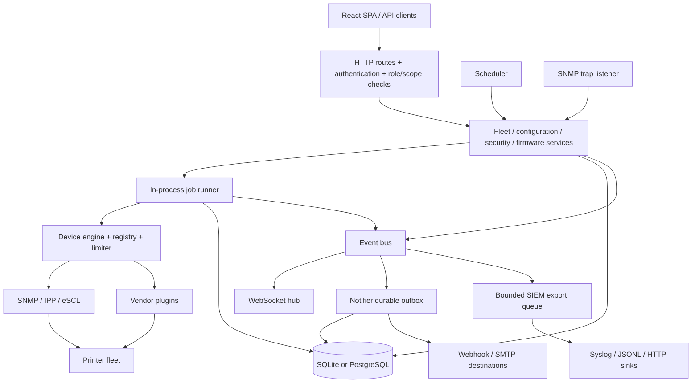

[Home](Home.md) · [Configuration reference](Configuration-reference.md) · [API reference](API-reference.md)

# Architecture

## One active server process

`cmd/printmarshal/main.go` loads configuration, opens and migrates the store, loads the encryption key, marks interrupted jobs, registers standards/vendor drivers, then wires the fleet, configuration, security, firmware and print-provider services. The same process serves the HTTP API and embedded SPA, schedules discovery/polls, receives SNMP traps, drains notifications and exports security events. PostgreSQL changes the persistence backend; it does not turn workers or the scheduler into a distributed system.

## Capability model and dispatch

A device stores a `capabilities` map from capability name to winning driver name, plus `identifyMethods` and `discoveryMethods`. Registry drivers declare capabilities, implement typed interfaces and provide priority/`Supports` methods. `Supports` must not perform network I/O. Identification queries registered identifiers, merges successful identities in descending priority, and assigns each capability to its highest-priority supplier.

Polling resolves the profile winner, then falls back to other drivers that identified that device and declare the requested capability. It reads status, supplies, trays, counters and firmware; each capability retains its `servedBy` driver or error. Reachability means at least one capability succeeded, not that every measurement was read. Missing status can be nil on a partial poll.

| Capability | Intended surface |
| --- | --- |
| `discover`, `identify` | Candidate discovery / identity; discovery itself is implemented in `internal/discovery`. |
| `read_status`, `read_supplies`, `read_trays`, `read_counters` | Monitoring and telemetry. |
| `read_config`, `write_config` | Normalized documents and per-setting configuration changes. |
| `read_security`, `write_security` | Policy inputs and remediation. |
| `manage_certs` | Driver certificate listing/installation. |
| `firmware_read`, `firmware_update` | Version observation and package delivery. |
| `subscribe_alerts` | Capability vocabulary for asynchronous device alerts; the trap listener is separately wired. |

See `internal/model/model.go`, `internal/engine/{engine,profile,write}.go`. Configuration merging reads every applicable config reader so a single document can combine IPP defaults, SNMP contact and vendor security facts. Write fallback offers skipped settings to another writer, retaining driver attribution and rollback values.

## Standards and vendor boundaries

SNMP supplies the system/Host Resources/Printer MIB baseline and limited SETs. IPP supplies printer attributes and supported `Set-Printer-Attributes` changes; its write transport handles challenge authentication and TLS pinning. eSCL identifies scanners/MFPs and reads scanner state. Vendor plugins match enterprise IDs/badges, enrich facts and declare only capabilities they can serve on an identified device. They are Go packages registered at startup, not dynamically loaded binary plugins.

The model catalogue is evidence data, not a driver. A documented vendor management route is not proof that a PrintMarshal transport exists. [Vendor plugins and drivers](Vendor-plugins-and-drivers.md) explains declarations, observed support and qualification.

## Jobs and control flow

`internal/jobs/runner.go` owns a channel of 1,024 queued jobs and a configurable worker pool (`jobs.workers`, default 4). Submission persists a queued job, publishes an update and enqueues it; a full queue fails submission. Handlers use `jobs.Context.SetTotal` and `Result`; per-device results persist independently and progress snapshots are synchronized/throttled. Terminal statuses include `succeeded`, `partial` and `failed`; the shared model also defines `cancelled`.

At startup, persisted queued/running jobs are marked failed with `interrupted by restart`. They are not rebuilt into the queue. Firmware has separate campaign recovery, persisted per-device state and an owning job ID, described in [Firmware](Firmware.md). A paused or scheduled campaign occupies a worker while its control loop waits; size workers with that in mind. No generic resume/cancel job API is registered.

## Events and persistence boundaries

The bus wraps each publication in an envelope with a UUID, version 1, event type/time, origin and payload. Subscriber invocation is synchronous after the subscriber list is copied. Implementations must bound their work. The WebSocket hub has a 256-message buffer per subscriber and drops on overflow. It has no persisted replay cursor.

The notifier inserts an outbox row for each subscribed event/destination, deduplicated by `(event_id, notifier)`, and retries deliveries. This makes an already-enqueued notification durable, not the original state transition and outbox insertion atomic. The bus itself has no event log or transaction with inventory/audit mutations. SIEM export uses a bounded in-memory queue and can drop; it is a different delivery guarantee from the notification outbox.

## Store boundary

`internal/store/store.go` defines the main `Store` plus feature facets in `store_*.go`. SQLite uses pure-Go `modernc.org/sqlite`, WAL, foreign keys, busy timeout 5 seconds, synchronous NORMAL and one open connection. PostgreSQL uses pgx, native JSONB/TIMESTAMPTZ/BYTEA and connection pooling; migrations take an advisory lock. Both persist inventory, jobs/results, telemetry, alerts, stock, credentials, settings and feature records. The main interface embeds the feature facets, including reports, logs and tokens; some services also reach them through local interface assertions. A new store must implement the entire contract.

AES-256-GCM protects device credential material and issued private keys. The key is supplied by `PM_SECRET_KEY` or retained in the data directory. User passwords are bcrypt hashes; session/API-token secrets are SHA-256 hashes. Application settings are records, while process config is file/env loaded at startup.

## SPA

`web/` is React/TypeScript with Vite. Build output goes to `internal/web/dist`; Go embeds it through `internal/web/embed.go`. The SPA uses REST for state and `/api/stream` for invalidation/live updates. Unknown UI paths fall back to the index page; assets are immutable-cacheable, index responses are no-store. A built backend only embeds whatever frontend assets existed when it was compiled.

## Known discrepancies

The specification mentions scalable durable queues and dynamically discovered plugins; this implementation has one in-process runner and compile-time registration. SQLite is not the only implemented store despite older comments. Persisted jobs are not generically resumable. See [Installation and deployment](Installation-and-deployment.md) for migration and single-active-instance limits.
